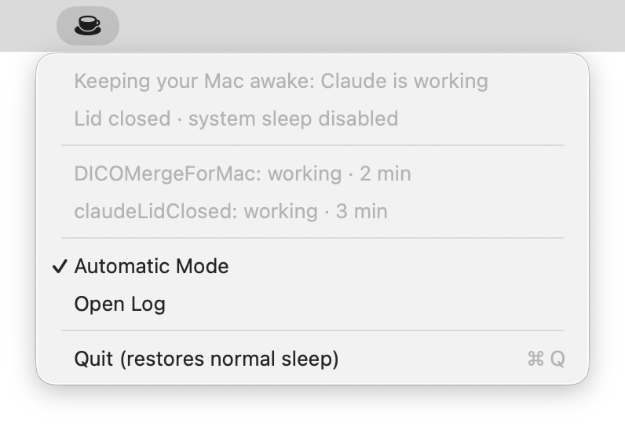

# Agent Lid Closed

**Close your MacBook's lid while Claude Code or Codex works. Your Mac stays awake with the screen at 0% brightness, then sleeps when every agent is waiting for you.**

[](LICENSE)
[](#install)
[](Package.swift)
[](#usage)

[Install](#install) · [Update](#updating) · [Usage](#usage) · [How it works](#how-it-works) · [Settings](#settings) · [Limits](#limits)

<p>
  <a href="docs/images/menu-lid-closed-working.png"></a>
</p>

_Real screenshot from the earlier Claude-only release. The current menu also labels each session as Claude or Codex and includes a display dimming switch._

## Overview

Closing a MacBook's lid normally puts it to sleep even while `caffeinate` is running. Agent Lid Closed follows Claude Code and Codex lifecycle hooks, keeping the Mac awake while either tool has work to do.

- **Both tools, together.** Claude and Codex sessions share one sleep decision. The Mac stays awake while any tracked session is working, including tracked subagents. T3 Code conversations are tracked directly, including hosts whose provider hooks are unavailable.
- **Screen at 0% with the lid closed.** The app turns the built-in backlight off while keeping a closed Mac awake, then restores the previous brightness when you open the lid.
- **Sleep when turns finish.** Finished turns and input questions allow sleep once every session is waiting and its grace period has passed. Claude approval prompts also allow sleep; Codex approval requests keep the hold until the tool finishes or you interrupt.
- **Wake before either tool's usage resets.** When Claude or Codex hits a known subscription limit, schedule a wake two minutes before the earliest reset. Both tools share the same sleep decision and wake alarm.
- **Switch accounts at a usage limit.** With two Claude (or Codex) accounts in T3 Code, a conversation that hits one account's limit continues on the other right away, instead of waiting for the reset.
- **Claude notifications still go out.** Claude sessions wait for Claude Code's delayed input notification. Codex sessions use the normal 10 s grace period without that extra wait.
- **See who is working.** Each menu row and terminal status line identifies the tool, project and activity.
- **Battery and heat limits.** At 15% battery or less on battery power, or serious thermal pressure, the app releases its sleep hold. Quitting restores sleep and brightness; launchd restarts the app after a crash to recover its saved state.
- **Small hooks, narrow access.** Event hooks write local state and produce no stdout. Root access permits the two `pmset disablesleep` settings and a root-owned helper that can only manage this app's wake alarms within the next seven days.

## Install

Requirements: a MacBook with macOS 14 or later and the Command Line Tools with Swift 6.2 or later (`xcode-select --install`; full Xcode isn't needed). Use any of [Claude Code](https://code.claude.com/docs/en/overview), a current [Codex CLI](https://learn.chatgpt.com/docs/cli) with lifecycle hooks, or [T3 Code](https://t3.codes); one is enough. Tested on macOS 26 on Apple silicon, with Codex CLI 0.163.0 hook configuration.

```sh
git clone https://github.com/Jin-hiroo/agent-lid-closed.git && cd agent-lid-closed && ./scripts/install.sh
```

The installer:

1. Builds `AgentLidClosed.app` and installs it in `~/Applications`.
2. Installs the wake helper at `/Library/PrivilegedHelperTools/local.AgentLidClosed.wake` and adds `/etc/sudoers.d/agent-lid-closed`, asking for your administrator password. The helper is root-owned and cannot be replaced by the app.
3. Adds hooks for the tools you have. Claude Code: hooks and a status-line wrapper in `~/.claude/settings.json`, plus `$CLAUDE_CONFIG_DIR/settings.json` if that is set. Codex: hooks in `~/.codex/hooks.json` (or `$CODEX_HOME/hooks.json`). A tool counts as installed if its command or config folder exists. Existing files are backed up to `.bak`; other settings and hooks are preserved. Your previous status-line command receives the same input and its output and display options are preserved. Uninstall restores it.
4. Enables T3 Code's native `autoResumeLimitedThreads` setting if `~/.t3/userdata/settings.json` exists. T3 reloads the setting while running; it applies to eligible blocked conversations, including existing ones. An explicitly disabled auto-resume preference is preserved on upgrades and reinstalls. Other T3 preferences are preserved.
5. Starts the app now and at login via `~/Library/LaunchAgents/local.AgentLidClosed.plist`.

Options, for tools or accounts the installer can't find on its own:

| Option | Effect |
| --- | --- |
| `--claude-config-dir DIR` | Also add hooks for a Claude account you run with `CLAUDE_CONFIG_DIR=DIR`. Repeat for more accounts. |
| `--codex` | Add Codex hooks even though Codex wasn't found. |
| `--no-claude`, `--no-codex` | Skip that tool. |

You can also add or remove hooks later in **Settings › Integrations**, without reinstalling. Every file that gets hooks is recorded in `~/Library/Application Support/AgentLidClosed/hook-targets.json`, so later installs keep them up to date and uninstalling removes them all.

Earlier versions didn't keep that record. If you installed one with `CLAUDE_CONFIG_DIR` or `CODEX_HOME` set, run the new installer once with the same variable set, or name the folder with `--claude-config-dir`, so those hooks are recorded too. Hooks already in `~/.claude` and `~/.codex` are found without help.

### Updating

From the folder you cloned:

```sh
git pull && ./scripts/install.sh
```

The installer rebuilds the app, replaces the running copy and refreshes every hook it recorded. Your settings are kept. Afterwards, restart open Claude Code sessions, and in Codex trust the hooks again under `/hooks` if it asks. Release notes are on the [Releases page](https://github.com/Jin-hiroo/agent-lid-closed/releases). To install a specific release instead of the latest code, check out its tag first, for example `git fetch --tags && git checkout v2.1`.

### Upgrading from Claude Lid Closed

Run the installer from this checkout after updating. It stops the old app, preserves preferences and session state, and replaces the old login agent. The old state path and `ClaudeLidClosed.app/Contents/Helpers/claude-lid-hook` remain compatible aliases so Claude sessions already open can keep reporting events. Your checkout directory does not need renaming.

The state directory may be a symlink to the existing Claude Lid Closed directory. This preserves the lock and files used by hooks that are already running.

Re-running the installer is supported. Remove the app, its power permissions and every hook it added with `./scripts/uninstall.sh`.

## Usage

1. For terminal sessions, restart Claude Code and Codex after installing so they load the hooks. T3 Code conversations are detected directly without restarting or trusting Codex hooks.
2. **In Codex, open `/hooks` and review/trust the Agent Lid Closed command hooks.** Codex skips new or changed hooks until trusted. Hooks must also be enabled in Codex configuration and allowed by policy. See the [official hook setup guide](https://learn.chatgpt.com/docs/hooks#review-and-trust-hooks).
3. Give either tool a task. The menu bar icon becomes a cup while work is active.
4. Close the lid. The Mac stays awake and the built-in display goes to 0% brightness.
5. When every tracked session is waiting, the Mac can sleep: normally after 10 s for Codex and Claude permission prompts, or 70–90 s after Claude finishes or asks a question, allowing its delayed notification to go out.

Open the lid to restore brightness. With an external display attached, macOS manages the built-in panel in clamshell mode; this app leaves brightness alone and does not force immediate system sleep.

Choose **Settings…** (⌘,) from the menu to adjust the app, and **Open Log** to view `~/Library/Logs/AgentLidClosed.log`.

To see the current sessions from a terminal:

```console
$ ~/Applications/AgentLidClosed.app/Contents/Helpers/agent-lid-hook status
Claude · DICOMergeForMac  working  (2 min)  b6b2cf46-59eb-4882-b8d5-fcc485fbbe24
Codex · agent-lid-closed  working  (3 min)  codex:thread-id
=> keep the Mac awake
```

### Wake when Claude or Codex limits reset

Leave the tracked sessions open, with hooks enabled. **Wake for Usage Resets** is enabled in this app's menu by default; Automatic Mode must also be on. The Mac stays awake while either provider is working. It can sleep when both are waiting, then wakes two minutes before the earliest known reset. If the first session exits or cancels its wait, the other session's wake is retained.

**Claude Code:** use **2.1.234 or later** with a Pro or Max subscription. The status-line wrapper records Claude's documented `rate_limits.five_hour` and `seven_day` percentages and reset timestamps locally. A `StopFailure` hook with `error: "rate_limit"` arms the wait. Keep **Continue automatically at usage limit** enabled in Claude's `/config` so the existing session continues after the reset.

**T3 Code (Claude and Codex):** leave T3 running. The app reads T3's local orchestration metadata from `~/.t3/userdata/statev2.sqlite` through a read-only SQLite connection. It follows running turns, reported background tasks, permission/input and secret requests, and the exact failed run and reset that T3 has armed for recovery. T3's native worker continues the same conversation at the reset, preserving context and permission mode and preventing duplicate continuations. A newer turn, cancellation, archive, settlement, recovery opt-out, or quitting T3 cancels the corresponding wake. Native state takes priority over duplicate hooks from T3-owned provider processes, including settled, archived and opted-out conversations. Those hooks cannot reappear as terminal quota waits. Inactive delegates of settled or archived ancestors are excluded; genuinely running children still keep the Mac awake. A terminal resuming the same conversation remains independently tracked. A later T3 snooze delays its wake until the snoozed recovery time. No account tokens or conversation text are collected.

The installer enables native continuation for T3 when no preference is set, and preserves an explicit opt-out. To enable it separately, run `python3 scripts/configure-t3.py`. Disable automatic continuation in T3's usage-limit recovery settings; this native preference persists after uninstalling Agent Lid Closed. The adapter targets the installed T3 orchestration-v2 schema; an unsupported schema reports an error and falls back to hooks. For a custom T3 userdata location, set `AGENT_LID_T3_DIR` in the app's launch environment.

**Codex outside T3:** the quota adapter targets the **0.163.0** local event format. Codex's [hooks](https://learn.chatgpt.com/docs/hooks#common-input-fields) supply a transcript path but no quota-failure event. The adapter reads only typed `event_msg` metadata from that file: `token_count.rate_limits.primary/secondary` windows and quota error codes. It doesn't read credentials or store conversation text. It saves its byte position so restarting this app can't replay a previously cancelled failure. The transcript format is explicitly unstable; missing or unknown data does not arm a wake. Hosts that don't provide a local JSONL transcript aren't covered by this adapter.

A wake is armed only for a live session with a confirmed quota failure and an exhausted window with a known reset. If both windows for that provider are exhausted, the later reset is used. The menu identifies the account whose quota resets next. T3 provider instances keep separate account identities and reset times, so two Claude subscriptions and a Codex subscription can run together. Account labels use the names configured in T3, such as **Claude**, **Claude - Second** and **Codex (ChatGPT - Personal)**. T3 recoveries support resets up to seven days away; terminal adapters retain their 24-hour wait horizon. The app holds the Mac awake from two minutes before the reset until activity resumes, or at most five minutes after the reset if it doesn't. Any other working Claude or Codex session keeps the normal hold throughout.

Apart from the account switch below, the app never sends a continuation prompt or launches a duplicate agent. **T3 Code handles Claude/Codex continuation at the reset through its native recovery worker.** Outside T3, Codex continuation depends on its host; waking the Mac alone doesn't start another Codex turn. Terminal Claude can use its native automatic continuation. Waking early matters because [Claude requires Enter after a long sleep that ends after the reset](https://code.claude.com/docs/en/interactive-mode#wait-for-a-usage-limit-to-reset).

Pause, disabling the wake toggle, session exit, continuation, reported cancellation, battery/thermal limits, and quitting clear the app's alarm. Other applications' wake schedules are preserved. Claude doesn't emit a cancellation hook when you press Esc during its quota countdown, so one previously scheduled wake may still occur; its hold remains bounded and Claude won't be prompted by this app.

**Closed-lid wake is best effort and needs testing on your Mac, preferably plugged in.** macOS can defer a scheduled wake or wake only briefly. Missing reset data, resets beyond the supported horizon (seven days for T3, 24 hours for terminal adapters), and unsupported host telemetry don't schedule a wake. Claude also needs its status line and native wait, which aren't available in headless/background sessions. Sleep preserves your logged-in session; shutdown/restart and FileVault login aren't automated. Permission prompts can still require your attention after work resumes.

### Switch to another account at a usage limit (T3 Code)

If T3 Code has more than one account of the same tool, such as **Claude** and **Claude - Second**, a conversation that hits one account's usage limit moves to another account and continues right away. It's optional: without T3 Code, or with one account per tool, nothing changes. **Settings › Usage Limits** shows the accounts it would use and turns it on or off; it's on by default, and the menu shows the same switch when it applies. It works independently of Automatic Mode.

The app sends T3 the same command as selecting the other account and pressing Resume: one `message.dispatch` that switches the conversation and starts the turn together, with the message "Continue where you left off. Claude reached its usage limit, so Agent Lid Closed moved this conversation to Claude - Second." T3 hands the conversation's context to the new account and keeps its permission mode. If T3 refuses the command, nothing changes and the conversation waits for its own reset as before.

- **Which conversations.** The failure must be a usage limit with a known reset, and the conversation must still use the limited account. A conversation moves if T3 has armed its automatic continuation or the failure is under 15 minutes old. Conversations you snoozed, opted out of automatic continuation, settled or archived stay put, as do those waiting for your input and delegated child tasks (their parent decides). Turning off automatic continuation in T3's usage-limit settings turns switching off too.
- **Which account.** An account of the same tool, configured in T3's settings and enabled for the conversation's project, that isn't known to be limited. T3's built-in instances aren't chosen unless they appear in its settings, because they may not be signed in. An account counts as limited until the reset of its latest usage-limit failure in any conversation, unless a run started after that failure has completed on it. Custom models must exist on the target account.
- **Both accounts limited.** The conversation waits. The Mac wakes for whichever reset comes first: the conversation's own, or another account's (one minute after it, so the estimate has passed). At that point it switches if the other account is free.
- **Limits.** Each conversation moves at most once every 10 minutes. Delivery is retried twice, 30 s apart, then the app gives up. The app checks the conversation again right before sending; if it changed meanwhile (new run, snooze, settlement, model change, switching turned off), the switch is withdrawn. The Mac stays awake while a switch is delivered, and for up to two minutes until T3 starts the continued run.
- **Access.** For each delivery the app asks T3's own `t3` command (`~/.t3/bin/t3`, installed by T3 Code) for a five-minute credential limited to running conversations, sends the command to T3's local server on `127.0.0.1`, then revokes the credential. Nothing is stored, and the credential never appears in the log. T3 ignores a repeated command ID, so a retry can't continue a conversation twice.

## How it works

The app uses the system-wide `SleepDisabled` setting (`pmset disablesleep`) to prevent lid-closed sleep. Hooks and T3's native orchestration state report activity; they do not change power settings themselves.

```text
Claude Code ── hooks ──▶ agent-lid-hook                  ──┐
Codex       ── hooks ──▶ agent-lid-hook --provider codex ──┤
                                                         ▼
                    sessions/<session key>.json ◀── menu bar app watches
                                                         ├─ sleep disabled while any agent works
                                                         └─ built-in brightness 0% with lid closed
```

Session files are in `~/Library/Application Support/AgentLidClosed/sessions/`. Codex IDs are namespaced separately from Claude IDs. Records written by the old Claude-only version still load.

- **Activity.** `UserPromptSubmit` and tool hooks mark work active. `SubagentStart`/`SubagentStop` track child activity without overwriting the main session. Claude's `Stop` payload can also report background tasks.
- **Waiting.** Codex `Stop`, `request_user_input` tool calls and `Interrupt` hooks mark a session as waiting. Its `PermissionRequest` keeps work active because an approval hook may allow a command without showing a prompt. Claude uses its question tools, notifications and stop events.
- **Grace periods.** Codex waits `sleepGraceSeconds` after entering a waiting state. Claude waits for its input notification, up to `notifyTimeoutSeconds`, or uses the shorter grace after the notification arrives.
- **Interruptions.** Claude does not emit an Esc hook. After 20 s without activity, its transcript is checked for `[Request interrupted by user]`. Codex uses its `Interrupt` hook and typed abort events; its local event reader also discovers quota failures.
- **Display.** Brightness is saved before setting it to 0. Once dimmed, it stays there during lid-closed sleep and is restored when the lid opens, checked twice a second. The saved value survives app restarts.
- **T3 Code.** Every 5 s, a short read-only SQLite transaction reads native activity and armed quota recovery. The live server PID and start time guard against abandoned runtime files. Real progress timestamps retain the normal stale-work limits. A temporary read failure retains activity for 60 s and preserves an already scheduled future alarm. Known T3 process ownership remains authoritative until the host exits, so an unavailable database cannot revive old terminal quota waits. The bridge never writes the T3 database. It dispatches a turn only for an account switch, through T3's command API.
- **Quota wakes.** The status-line command, Codex event reader and hooks share the same file lock. Unchanged Claude status-line telemetry is written at most once every 30 s. Quota telemetry preserves the owning process and doesn't refresh its activity heartbeat. A confirmed Codex quota failure marks that session waiting. A fixed root-owned helper schedules/cancels only wake events tagged `local.AgentLidClosed.quota`; it cannot shut down or power on the Mac. The app re-checks absolute reset times after wake and recovers its alarms after a crash.

### Safety

- **Battery.** At or below the configured floor on battery power, normal sleep is restored.
- **Heat.** macOS thermal state “serious” or “critical” releases the sleep hold.
- **Exit and crash recovery.** Normal termination restores sleep and brightness. After a crash, launchd restarts the app so it can recover the hold marker and `dimmed-brightness` file.
- **Visible restoration.** Brightness is restored to at least 10%, even if macOS reported 0 before dimming.
- **Dead or stale sessions.** Sessions whose owning process exits are dropped. For app-server hosts, that process can outlive an individual conversation; cleanup then relies on `SessionEnd` or stale timeouts. Work without a hook event for 30 minutes is ignored; Claude background-only work expires after 60 minutes. PID start times distinguish reused process IDs.

## Menu

| Icon | Meaning |
| --- | --- |
| Cup | At least one agent is working; sleep is disabled |
| Hourglass | All sessions are waiting; the grace period is running |
| Moon | Normal sleep |
| Pause | Automatic Mode is off |
| Warning triangle | Setup needed, low battery or thermal limit; normal sleep |

The menu lists each session's tool, project and activity, plus lid state, system sleep state and whether the display is off. **Automatic Mode** controls sleep management. **Turn Display Off When Lid Closed** controls dimming and is on by default. **Wake for Usage Resets** controls the shared Claude/Codex quota wake alarm and is also on by default. **Switch Accounts at Usage Limits** appears only when T3 Code has two accounts of one tool; it moves a limited T3 conversation to another account and is on by default. The latest switch, or why one failed, appears under the status. **Settings…**, **Open Log** and **Quit** are available.

## Settings

Choose **Settings…** (⌘,) from the menu. Changes take effect within 5 s.

| Tab | What you can change |
| --- | --- |
| General | Automatic Mode, display off with the lid closed, start at login, and the battery level that allows sleep |
| Timing | How long to wait after agents stop before sleeping, how long to wait for Claude's notification, and when silent or background-only sessions stop keeping the Mac awake |
| Usage Limits | Waking before usage resets, and T3 Code account switching with the accounts it would use. Switching is greyed out with the reason when it can't apply, for example without T3 Code or with one account per tool |
| Integrations | Which Claude Code and Codex settings files have hooks, with buttons to add or remove them; **Add Config Folder for Another Account…** for a Claude account you run with `CLAUDE_CONFIG_DIR`; T3 Code and power permission status |

Turning off **Start at login** disables the login agent; the running app keeps running, and reinstalling keeps your choice.

The same preferences can be scripted with `defaults write local.AgentLidClosed <key> <value>`. Existing preferences from `local.ClaudeLidClosed` are copied once on upgrade unless the new domain already has a value.

| Key | Default | Meaning |
| --- | --- | --- |
| `notifyTimeoutSeconds` | 90 | Claude only: longest wait for the delayed input notification; 0 skips that wait |
| `sleepGraceSeconds` | 10 | Delay after a waiting notification, or after Codex starts waiting |
| `batteryFloorPercent` | 15 | At or below this percentage on battery power, allow sleep |
| `workingStaleMinutes` | 30 | Ignore working sessions and subagent markers after this long without events |
| `backgroundStaleMinutes` | 60 | Ignore Claude background-only work after this long without events |
| `wakeForQuotaReset` | true | Wake before usage resets (`-bool`) |
| `switchAccountAtLimit` | true | Switch T3 Code accounts at a usage limit (`-bool`) |

## Limits

- **Codex hook trust outside T3.** Installing the file does not trust the hooks. Review them through `/hooks` before relying on this app. Older Codex versions without these lifecycle events are unsupported.
- **Approval prompts.** Codex has no approval-accepted hook, and another hook can auto-allow a command. The app therefore keeps Codex awake through approval requests until tool completion, turn completion or interruption (subject to stale timeouts). For Claude, approving and immediately closing the lid can still allow sleep until that tool completes; bypassing permission prompts avoids that gap.
- **Codex background work.** Detached commands that outlive a completed turn are not included in Codex's `Stop` payload. They are not independently tracked. Claude background tasks and lifecycle-reported subagents are tracked.
- **Other scheduled work.** Only supported Claude/Codex subscription-limit waits schedule a wake. Timers and other scheduled future turns do not keep the Mac awake between turns.
- **Hooks that continue a turn.** Another `Stop` or `SubagentStop` hook can request more work after this app has recorded completion. Until the next activity hook, the session may count as waiting. Increase the grace period or turn off Automatic Mode for long continuation-only workflows.
- **Manual sleep.** macOS may ignore manual sleep while the hold is active. Turn off Automatic Mode or quit first.
- **Private brightness API.** Apple silicon brightness control uses `DisplayServices`. If a future macOS removes that API, dimming is skipped and a failure is logged.
- **Other hosts and remote work.** Only hosts that load and run the configured local hooks are visible. Cloud sessions and hosts that skip hooks are not tracked; a running process alone does not imply an active turn.

## Development

```sh
swift build                    # debug build, when SwiftPM is available
./scripts/test-hook.sh         # Claude + Codex hook/state regression checks
python3 scripts/test-install.py # hook merging and upgrade compatibility checks
./scripts/build-app.sh         # build/AgentLidClosed.app
./scripts/test-quota.sh         # reset planning + hook/status-line/app dry-run checks

# Dry runs can coexist with the installed app:
python3 scripts/test-display.py # both tools: dim, sleep, restore; no real power changes

# Run manually in dry-run mode:
AGENT_LID_DRY_RUN=1 AGENT_LID_FAKE_LID=closed AGENT_LID_STATE_DIR=/tmp/agent-lid \
  build/AgentLidClosed.app/Contents/MacOS/AgentLidClosed \
  -notifyTimeoutSeconds 6 -sleepGraceSeconds 2
```

The scripts fall back to direct `swiftc` builds if SwiftPM cannot start. With a mismatched local SDK, set `AGENT_LID_SDK` to a compatible SDK path for that fallback. For example, this machine's Swift 6.3 compiler works with `AGENT_LID_SDK=/Library/Developer/CommandLineTools/SDKs/MacOSX26.5.sdk`.

In a dry run, `AGENT_LID_OPEN_SETTINGS=1` opens Settings at launch, `AGENT_LID_SETTINGS_TAB=0…3` picks its tab, and `AGENT_LID_HOME` points Integrations at another home folder. Add and Remove change only files under `AGENT_LID_HOME`, and only with `AGENT_LID_STATE_DIR` set; otherwise they are logged. Power and brightness changes are logged. Create `/tmp/agent-lid/lid-open` to simulate opening the lid. The old `CLAUDE_LID_STATE_DIR`, `CLAUDE_LID_DRY_RUN` and `CLAUDE_LID_FAKE_LID` variables remain accepted.

## License

[MIT](LICENSE). Agent Lid Closed was previously named Claude Lid Closed. It is an independent project, not affiliated with or endorsed by Anthropic or OpenAI. Claude and Claude Code are trademarks of Anthropic; Codex is an OpenAI product.
